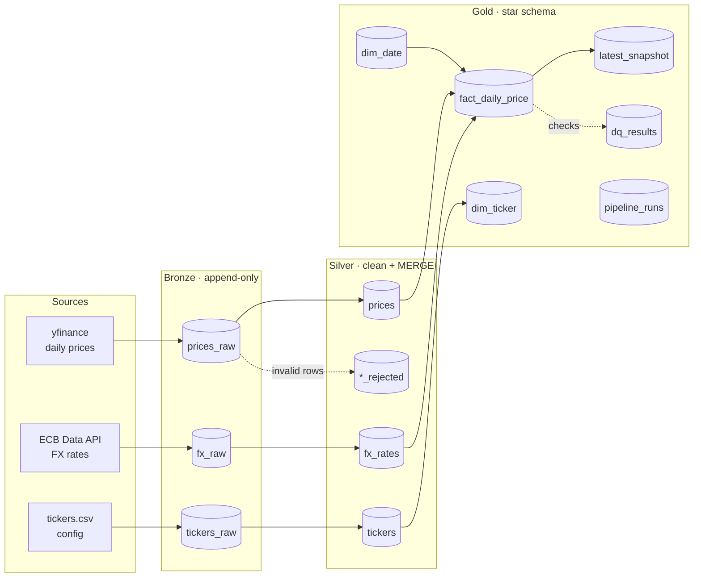
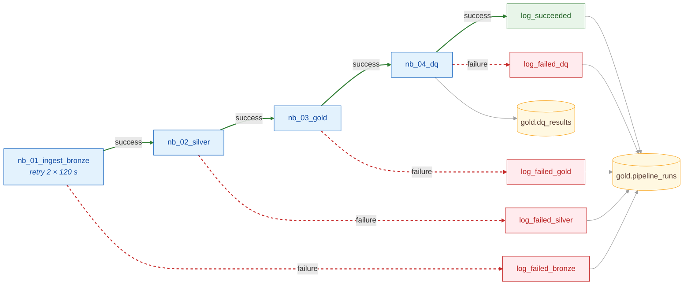

# fabric-market-monitor

A daily pipeline that ingests Swiss and Italian blue-chip prices and ECB exchange rates, cleans them through a **medallion architecture** (bronze → silver → gold), models them as a **star schema** in a common currency (CHF), checks **data quality** on every run and logs every pipeline run.

Built as a hands-on learning project, with every friction point of adopting Fabric documented in [ADOPTION_NOTES.md](ADOPTION_NOTES.md).

> **Business question**: How did the largest Swiss and Italian companies perform?
Considering the return, volatility, drawdown and the fact that everything is measured in the same currency

---

## Architecture



## Orchestration



Every branch ends in `nb_05_log_run`, which writes one row per run to `gold.pipeline_runs`. The pipeline run id is passed to the data quality notebook too, so a run and its checks can be joined on `run_id`.

## Tech stack

- Microsoft Fabric (Lakehouse with schemas, Spark notebooks, Data pipeline, SQL analytics endpoint) 
- PySpark & Spark SQL 
- Delta Lake 
- Python (pandas, requests, yfinance) 
- Git integration with GitHub.

## Data

| Source | Content | Notes |
|---|---|---|
| yfinance | Daily OHLCV for 15 stocks (8 SMI, 7 FTSE MIB) since 2019 | List driven by `data/tickers.csv` (config, not code) |
| ECB Data API (SDMX) | CHF, USD, GBP per 1 EUR, daily since 2019 | 404 *or* an empty 200 response = no data for the period |

About 30k price rows and 6k FX rows (Nov 2026).

## Data model

| Table                                                      | Layer  | Grain / key                                                                              | Write strategy                         |
| ---------------------------------------------------------- | ------ | ---------------------------------------------------------------------------------------- | -------------------------------------- |
| `bronze.prices_raw`, `bronze.fx_raw`, `bronze.tickers_raw` | bronze | one row per downloaded record + lineage columns (`_ingested_at`, `_source`, `load_date`) | append, schema contract                |
| `silver.prices`                                            | silver | ticker × date                                                                            | deduplication + validity rules + MERGE |
| `silver.fx_rates`                                          | silver | currency × date                                                                          | deduplication + validity rules + MERGE |
| `silver.*_rejected`                                        | silver | rejected rows + `reject_reason`                                                          | append (created at the first reject)   |
| `gold.dim_ticker`                                          | gold   | ticker (natural key)                                                                     | full rebuild                           |
| `gold.dim_date`                                            | gold   | calendar day (`date_key` yyyymmdd)                                                       | full rebuild                           |
| `gold.fact_daily_price`                                    | gold   | ticker × trading day                                                                     | full rebuild                           |
| `gold.latest_snapshot`                                     | gold   | ticker (latest day, YTD return)                                                          | full rebuild                           |
| `gold.dq_results`                                          | gold   | run × check                                                                              | append (history)                       |
| `gold.pipeline_runs`                                       | gold   | pipeline run                                                                             | append (history)                       |

`fact_daily_price` holds prices in local currency and in CHF (forward-filled FX, cross rate via EUR), daily returns, 20-day moving average, 30-day annualised volatility and drawdown.

## Data quality

`nb_04_dq` runs 14 checks on every pipeline run, grouped by dimension:

| Dimension | Checks |
|---|---|
| Uniqueness | keys of silver prices and FX, fact grain, one snapshot row per ticker |
| Completeness | every silver row reaches the fact; every configured ticker has prices |
| Validity | positive CHF prices; new rejected rows since the last check |
| Consistency | fact keys exist in `dim_date` / `dim_ticker`; every fact row has an FX rate |
| Timeliness | latest price / FX date within 3 business days |

Each check is a SQL query that returns the *bad* rows (0 rows = passed).Results are stored, to allow quality to be tracked over time. A failed check flags the run (`succeeded_with_warnings`) without blocking it.

## Repository structure

```
fabric/                    Fabric items synced by Git integration (notebooks, pipeline, lakehouse, environment)
data/tickers.csv           list of tracked stocks
requirements.txt
ADOPTION_NOTES.md          friction log: what blocked me while using Fabric and how I solved it
```

## How to run it

1. A Fabric capacity and a workspace connected to this repo via Git integration (folder `fabric/`).
2. Lakehouse `lh_market` with schemas enabled (`bronze`, `silver`, `gold`); upload `data/tickers.csv` from Github to `Files/reference/` in the Fabric workspace.
3. Environment `env_market` with `yfinance` 1.8.0, installed once in the environment instead of with `%pip` in the notebook (pinned version, no package install at runtime). It is attached to **all five notebooks**, enabling a shared Spark session (which requires the same environment).
4. Workspace settings → Data Engineering/Science → Spark settings → High concurrency: enable **For pipeline running multiple notebooks**. Every notebook activity in the pipeline uses the session tag `market`.
5. Run the pipeline `pl_daily_market`.
6. Check the results:

```sql
SELECT r.run_id, r.status, r.dq_status, r.duration_seconds, COUNT(d.check_name) AS checks
FROM gold.pipeline_runs AS r
LEFT JOIN gold.dq_results AS d ON r.run_id = d.run_id
GROUP BY r.run_id, r.status, r.dq_status, r.duration_seconds
```

The schedule (Mon–Fri 07:00) is configured, but disabled.

## Design decisions

- **Incremental and idempotent.** Bronze uses a watermark per ticker (last date + 1, never today's partial bar); silver uses a watermark on `_ingested_at` and MERGE on the business key; gold is rebuilt in full (small data, windows over the whole history), allowing full fixing if something changes in the silver notebook. Running twice gives the same result.
- **Schema contract in bronze.** Fixed types and NaN → null, after a real `DELTA_FAILED_TO_MERGE_FIELDS` error on `volume`.
- **One ticker per download.** Avoids NaN from aligning Swiss and Italian trading calendars and isolates errors.
- **Invalid rows are never deleted.** They go to `*_rejected` with a reason (to allow future checks with history).
- **Retry only where errors can be transitory.** Bronze depends on external APIs (2 retries, 120 s); a logic error in silver or gold would fail again, so no retry there. Timeout of 30 minutes per activity.
- **One failure branch per step.** In Data Factory, dependencies coming from *different* activities are combined with AND: a single shared "on failure" handler would only run if every step failed. One branch per step also records *which* step failed.
- **Failed runs stay failed.** The logging notebook raises an exception after writing a `failed` row; otherwise the error would count as handled and the run as succeeded.
- **One shared Spark session for the whole pipeline.** Most of the run time was Spark start-up: every notebook started its own session (546 s end to end with no new data). The pipeline now runs in high concurrency mode with the same session tag on every notebook activity, so the first notebook starts the session and the others attach to it. Run time dropped to **269 s (about −50%)**; silver and gold went from ~2.5–3 min to ~50 s each. I first considered dropping the environment and running `%pip install yfinance` in bronze, but `%pip install` is not supported in high concurrency mode and is disabled by default in pipeline runs, because dependencies can change from run to run, so I did the opposite: one environment for all notebooks.
- **Data quality signals, it does not block.** Appropriate for non-critical analytical data; a stricter setup would stop before publishing gold.

## Known limits and next steps

- **Adjusted close is restated by Yahoo** at every dividend; with incremental loads older rows keep the old value. Options: compute returns from close + dividends, reload the last N days, or a periodic full reload.
- **Freshness ignores holidays** (3-business-day tolerance). A proper fix is an exchange calendar per market.
- **Natural key in `dim_ticker`.** Next: surrogate key + **SCD type 2** (a real case already happened: Roche `ROG.SW` → `RO.SW`).
- **The first notebook still pays the session start-up** (~1.5–2 min of the ~4.5 min run), and one high concurrency session is shared by at most 5 notebooks per session tag (enough for this pipeline: 4 steps + 1 log per run).
